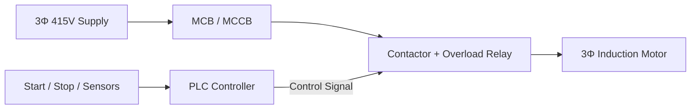
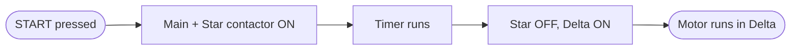

<!-- NOTE: Agar aapka username "anup-automation" nahi hai, to neeche "anup-automation" ko apne username se replace karo -->

<!-- ═══════════ HEADER ═══════════ -->
<p align="center">
  
</p>

<p align="center">
  
</p>

<p align="center">
  
  
  
  
</p>

---

## 🪪 Engineer Nameplate

| ⚙️ Parameter | 📋 Rating |
|:------------|:---------|
| **Name** | Anup |
| **Qualification** | Diploma in Electrical Engineering |
| **Domain** | PLC & Industrial Automation |
| **Focus** | Ladder Logic, Motor Control, Interlocking |
| **PLC Platform** | Allen-Bradley (Studio 5000 / RSLogix) |
| **Currently Learning** | Timers, Counters, SCADA / HMI, VFD basics |
| **Status** | 🟢 Energized & Learning |
| **Connect** | [LinkedIn · anup80](https://www.linkedin.com/in/anup80/) |

---

## 🔌 How My System Works (Single Line Diagram)



---

## 🧠 Ladder Logic Snapshot: Start-Stop with Seal-in

```text
 L1 |                                                    | L2
    |──┬──┤ START ├──┬──┤/ STOP ├──┤/ OL ├──( MOTOR )──|
    |  │            │
    |  └──┤ MOTOR ├──┘
    |
    |   START  = Normally Open push button
    |   STOP   = Normally Closed push button
    |   OL     = Overload relay contact
    |   MOTOR  = Output coil + seal-in (hold) contact
```

---

## 🎛️ Control Panel: Skills

| 🔧 Area | 🛠️ What I work on | 📶 Level |
|:-------|:------------------|:--------|
| **PLC Programming** | Ladder Logic, I/O mapping, logic gates | ✅ Practicing |
| **Motor Control** | DOL, Star-Delta starter, interlocking | ✅ Practicing |
| **Timers & Counters** | Sequencing, delay-based control | 🔄 Learning |
| **Electrical Basics** | 3-phase systems, control circuits, protection devices | ✅ Practicing |
| **SCADA / HMI** | Monitoring and operator interface | 🌱 Exploring |
| **VFD & Sensors** | Speed control, proximity / limit sensing | 🌱 Exploring |

<p align="center">
  
  
  
  
  
</p>

### 🧰 Tools & Software

<p align="center">
  
  
  
</p>

---

## 🚀 Project Panel

| 🔹 Project | 📝 What it does | ⚡ Concepts | 🔗 Link |
|:----------|:---------------|:-----------|:-------|
| **All Gate Ladder Logic** | AND, OR, NOT, NAND, NOR, XOR & XNOR gates in ladder logic | Logic gates, I/O | [View](https://github.com/anup-automation/All-Gate-Ladder-Logic-Programe-) |
| **PLC Interlocking System** | Equipment interlocking for safe industrial operation | Interlocking, safety | [View](https://github.com/anup-automation/PLC-Interlocking-System) |
| **Star-Delta Starter Control** | Automatic Star → Delta switching of a 3-phase induction motor | Timers, motor control | [View](https://github.com/anup-automation/Star-Delta-Starter-PLC-Control) |

### ⭐ Star-Delta Sequence



---

## 🗺️ Learning Roadmap

- [x] Basic logic gates in ladder logic
- [x] Interlocking systems
- [x] Star-Delta starter
- [ ] DOL & Forward-Reverse motor control
- [ ] Timer / Counter based conveyor sequence
- [ ] Tank level control system
- [ ] Traffic light control
- [ ] SCADA / HMI basics
- [ ] VFD based speed control

---

## 📊 GitHub Stats

<p align="center">
  
  
</p>

---

## ⚠️ Safety First

> **De-energize. Lock out. Verify. Then work.**
> Good automation is not just smart, it is safe.

<p align="center">
  <a href="https://www.linkedin.com/in/anup80/">
    
  </a>
</p>

<!-- ═══════════ FOOTER ═══════════ -->
<p align="center">
  
</p>
